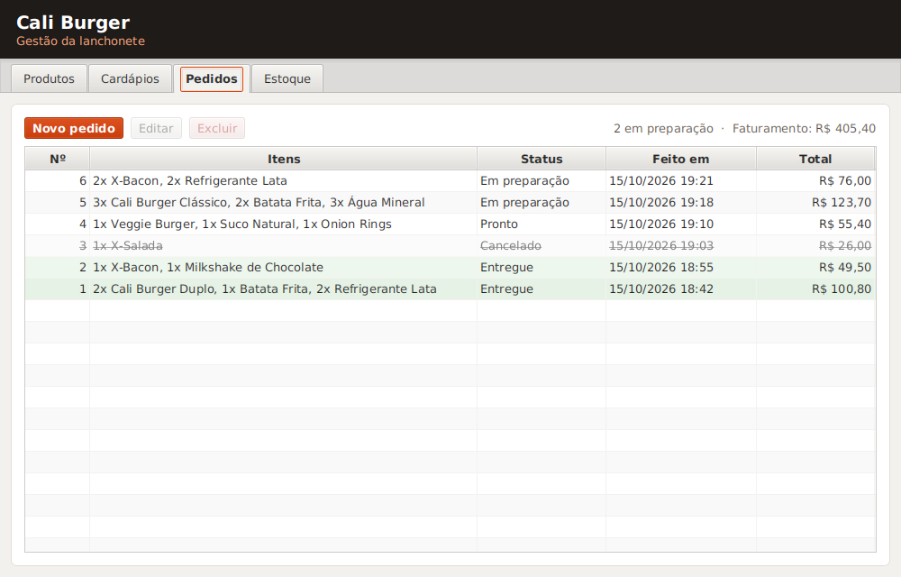
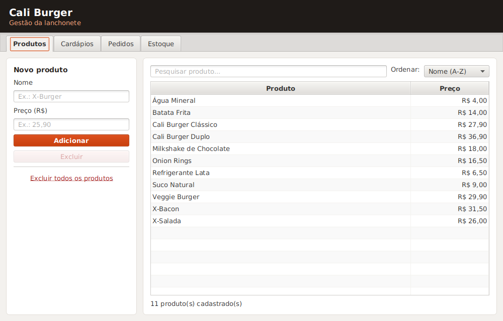
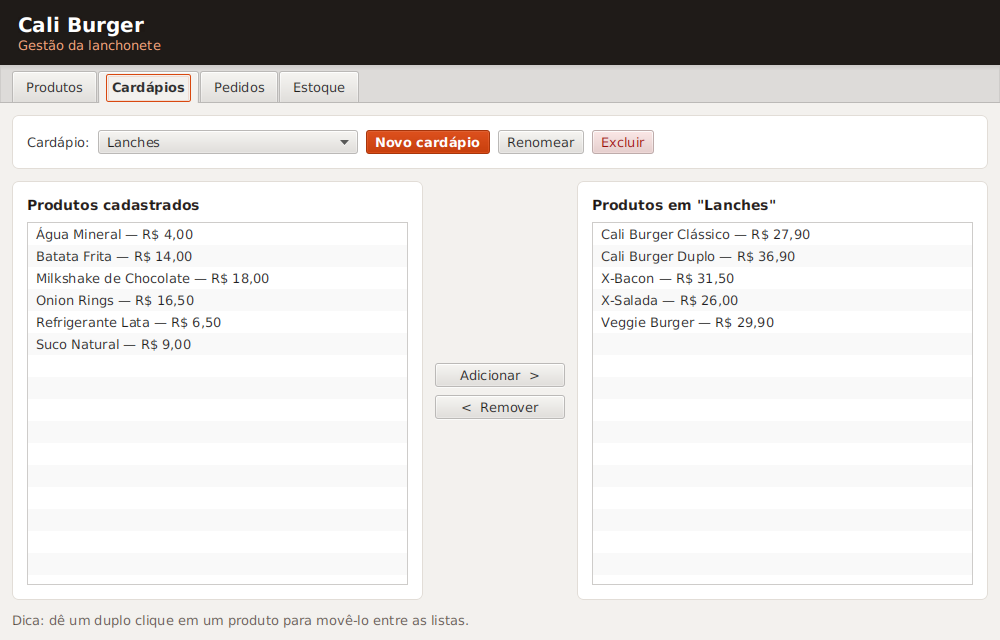
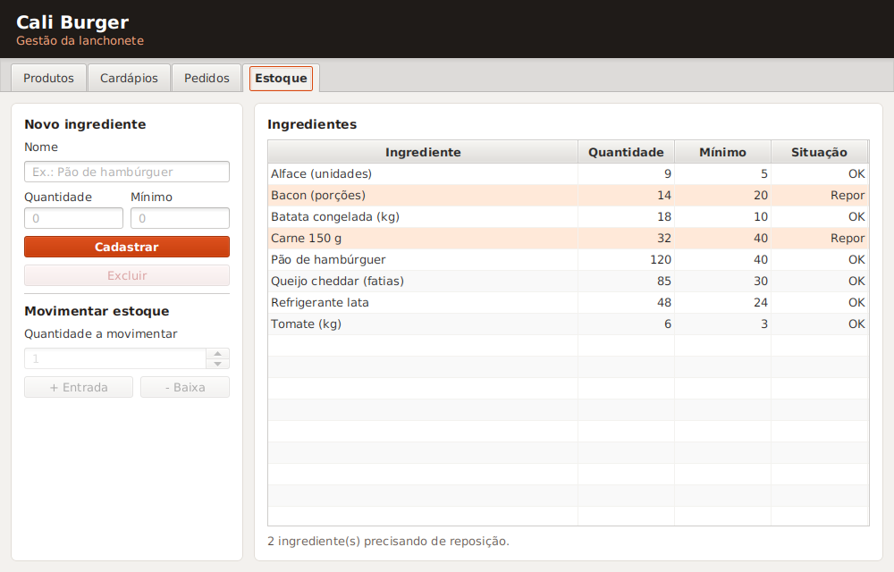
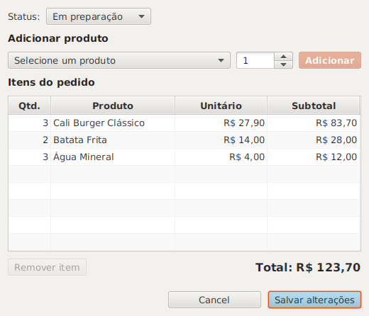
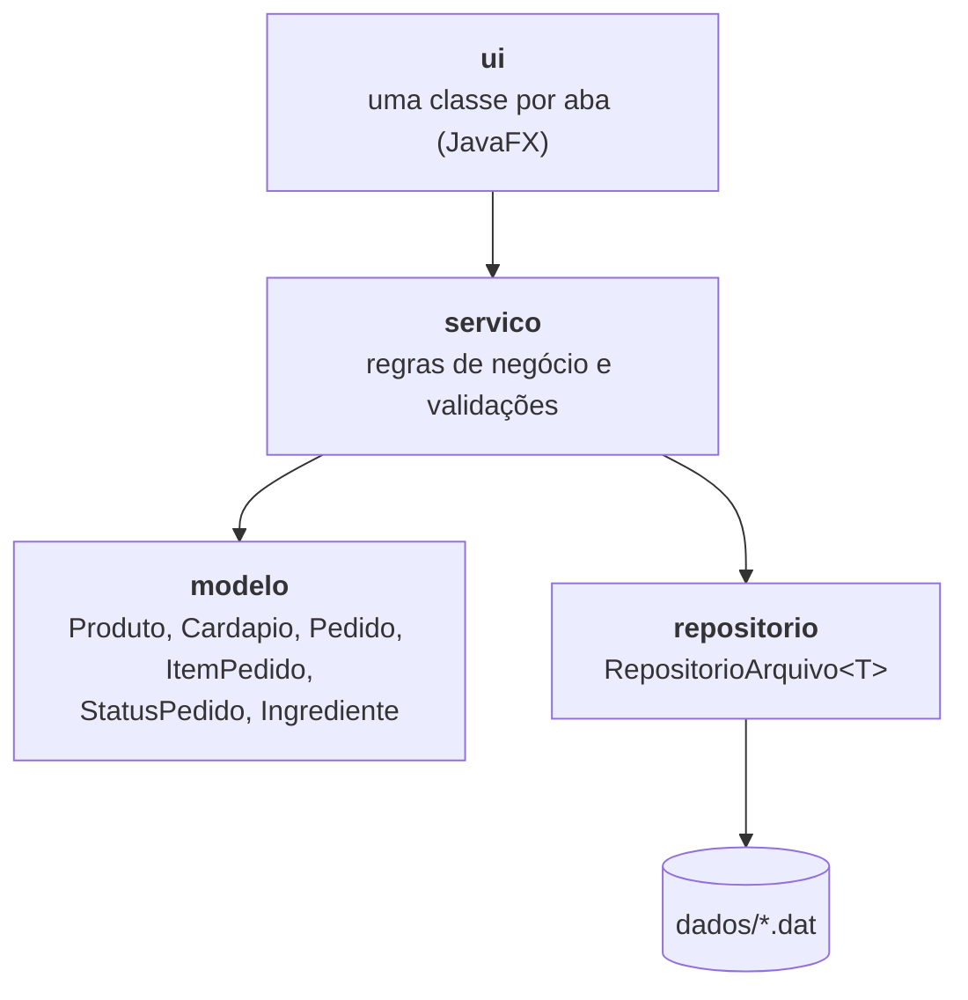

# 🍔 Cali Burger

[](https://github.com/SPTulio/cali-burger-java/actions/workflows/build.yml)


Sistema desktop de gestão para uma lanchonete fictícia, a **Cali Burger**: cadastro de produtos, montagem de cardápios, registro de pedidos e controle de estoque.

Projeto da disciplina de **Programação Orientada a Objetos**, desenvolvido em equipe em Java com JavaFX.



## Funcionalidades

| Aba | O que faz |
| --- | --- |
| **Produtos** | Cadastro, edição e exclusão de produtos; pesquisa sem diferenciar maiúsculas e acentos; ordenação por nome ou preço |
| **Cardápios** | Criação de cardápios (ex.: Lanches, Bebidas) e escolha dos produtos de cada um; mudanças no produto aparecem automaticamente nos cardápios |
| **Pedidos** | Novo pedido com quantidade por item, alteração de itens e status (em preparação, pronto, entregue, cancelado), total e resumo do faturamento |
| **Estoque** | Ingredientes com quantidade e estoque mínimo, entradas e baixas, e destaque para o que precisa de reposição |

Os dados ficam salvos em arquivos na pasta `dados/` e são carregados ao abrir o programa.

<table>
  <tr>
    <td></td>
    <td></td>
  </tr>
  <tr>
    <td></td>
    <td></td>
  </tr>
</table>

## Como executar

Pré-requisitos: **JDK 21** e **Maven** (ou uma IDE como IntelliJ IDEA, que já traz o Maven).

```bash
git clone https://github.com/SPTulio/cali-burger-java.git
cd cali-burger-java
mvn javafx:run      # abre o programa
mvn test            # roda os testes
```

No IntelliJ: abra a pasta do projeto, espere o Maven baixar as dependências e rode a classe `com.caliburger.App` (ou o comando `javafx:run` na aba Maven).

## Arquitetura

O código é dividido em camadas, e as regras de negócio não dependem da interface gráfica, o que permite testá-las sem abrir janelas.



```text
src/main/java/com/caliburger/
├── App.java                     # janela principal
├── modelo/                      # entidades do domínio
├── repositorio/                 # persistência genérica em arquivo
├── servico/                     # regras de negócio
├── ui/                          # telas (Produtos, Cardápios, Pedidos, Estoque)
└── util/                        # formatação de moeda
src/test/java/com/caliburger/    # testes JUnit 5
```

### Conceitos de POO aplicados

- **Encapsulamento e validação:** cada entidade garante o próprio estado válido (preço maior que zero, estoque nunca negativo, pedido com pelo menos um item).
- **Identidade de objetos:** produtos e cardápios têm um `UUID`, com `equals` e `hashCode` baseados nele. Assim, renomear um produto não quebra as referências.
- **Generics:** uma única classe `RepositorioArquivo<T>` salva e carrega qualquer tipo de entidade.
- **Enum com comportamento:** `StatusPedido` traz a descrição e as regras de cada etapa.
- **Interface e polimorfismo:** todas as abas implementam `Tela`, e a janela principal as trata de forma uniforme.
- **Records e imutabilidade:** `ItemPedido` guarda nome e preço do produto no momento da venda, então alterar o cardápio não muda pedidos antigos.
- **Separação de responsabilidades:** modelo, persistência, regras de negócio e interface em camadas independentes.

### Decisões técnicas

- **Valores em `BigDecimal`**, para evitar erros de arredondamento de `double` com dinheiro.
- **Gravação segura:** os dados são gravados em um arquivo temporário que depois substitui o original. Uma queda de energia no meio da gravação não corrompe o arquivo, e um arquivo ilegível é preservado com outro nome em vez de ser apagado.
- **Horário injetável (`Clock`)** no serviço de pedidos, para os testes controlarem datas e horas.

## Testes

São 31 testes automatizados com JUnit 5, cobrindo as regras de negócio e a persistência: validações, nomes duplicados, ordenação em português, numeração de pedidos após reabrir o sistema, preço histórico dos pedidos, estoque mínimo e recuperação de arquivos corrompidos.

A cada push e pull request, o **GitHub Actions** compila o projeto, roda os testes e abre a interface em uma tela virtual para gerar as capturas acima, o que também confirma que todas as telas são montadas sem erros.

## Próximos passos

- Baixa automática do estoque a partir das receitas dos produtos vendidos
- Relatórios de vendas por período
- Banco de dados (ex.: SQLite) no lugar dos arquivos

## Equipe

- Adnan Charif
- Henrique Szlachta
- Lucas Kumagae — [@lucaskumagae](https://github.com/lucaskumagae)
- Sérgio Pizzatto Tulio — [@SPTulio](https://github.com/SPTulio)
